

  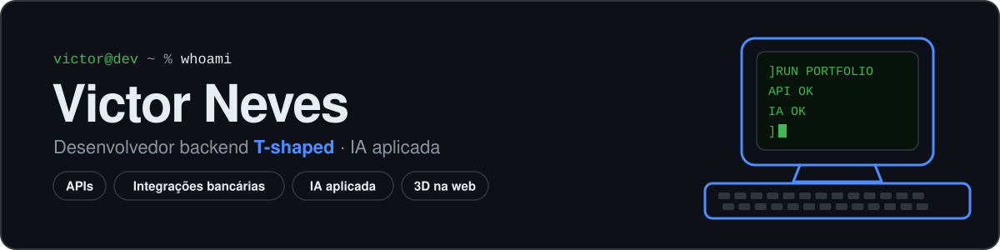

  Construo APIs, integrações bancárias e webhooks, e hoje trabalho principalmente com <b>IA aplicada</b>: 
  agentes, MCPs e automações ligadas a sistemas reais. Também faço front-end, mobile e 3D na web.

  

<h3 align="center">Projetos</h3>

Quase todo o meu código é privado, então estes cartões fazem o papel dos repositórios.

  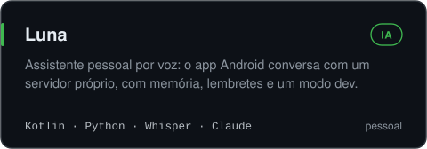
  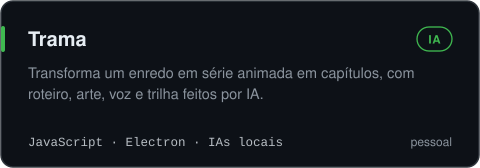

  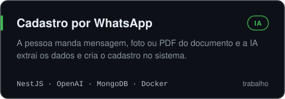
  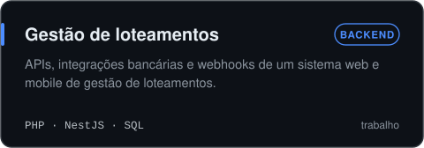

  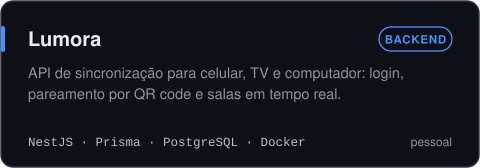
  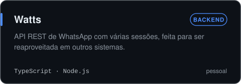

  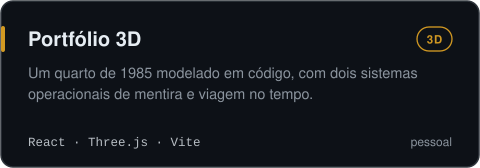
  <a href="https://3d.yachtresidence.com.br/">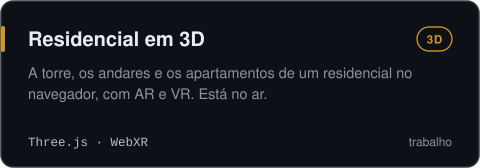</a>

  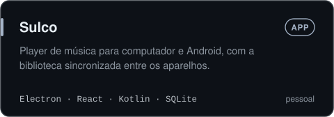
  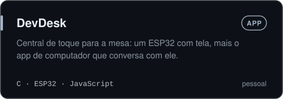

<h3 align="center">Atividade</h3>

Os números incluem as contribuições em repositórios privados.

  
  

  

