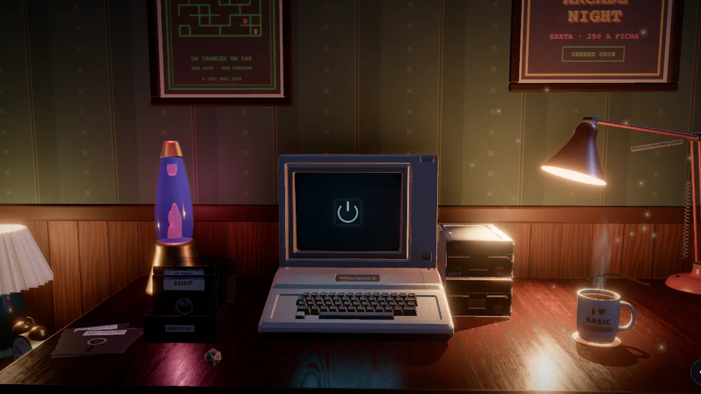

# Victor Neves

Desenvolvedor backend (T-shaped). Faço APIs, integrações bancárias e webhooks em NestJS e PHP, e hoje trabalho principalmente com **IA aplicada**: agentes, MCPs e automações ligadas a sistemas reais. Também entrego front-end, mobile (Kotlin e Swift) e 3D na web.

## O que eu tenho feito

Quase todo o meu código é privado (produtos da empresa e projetos pessoais em andamento), então este resumo faz o papel dos repositórios.

### No trabalho

- **Gestão de loteamentos:** APIs, integrações bancárias e webhooks de um sistema web e mobile (PHP, NestJS, SQL).
- **Cadastro por WhatsApp com IA:** a pessoa manda mensagem, foto ou PDF do documento e a IA extrai os dados e cria o cadastro no sistema (NestJS, OpenAI, MongoDB). Backend feito em equipe.
- **Apresentação 3D de um residencial:** a torre, os andares e os apartamentos no navegador, com AR e VR (Three.js, WebXR). No ar em [3d.yachtresidence.com.br](https://3d.yachtresidence.com.br/).

### Projetos pessoais

| Projeto | O que é | Stack |
|---|---|---|
| **Luna** | Assistente pessoal por voz: app Android que conversa com um servidor próprio, com memória, lembretes e um modo dev | Kotlin, Python, Whisper, Claude |
| **Trama** | Painel que transforma um enredo em série animada em capítulos, com roteiro, arte, voz e trilha feitos por IA | JavaScript, Electron, IAs locais |
| **Portfólio 3D** | Um quarto de 1985 modelado em código, com dois sistemas operacionais de mentira e viagem no tempo | React, Three.js |
| **Lumora** | API de sincronização para um app de vídeo em celular, TV e computador: login, pareamento por QR code e salas em tempo real | NestJS, Prisma, PostgreSQL, Docker |
| **Sulco** | Player de música para computador e Android com biblioteca sincronizada | Electron, React, Kotlin, Node, SQLite |
| **Watts** | API REST de WhatsApp com várias sessões, feita para ser reaproveitada em outros sistemas | TypeScript |
| **DevDesk** | Central de toque para a mesa, num ESP32 com tela, mais o app de computador | C, JavaScript |

## Stack

- **Backend:** TypeScript (Node.js, NestJS), PHP, SQL e NoSQL, Docker
- **IA:** agentes, RAG, MCPs, extração de dados de documentos, voz
- **Front-end e mobile:** React, Next.js, React Native, Kotlin, Swift
- **3D:** Three.js, WebXR

## Atividade

Como os repositórios são privados, os números abaixo incluem as contribuições privadas.

